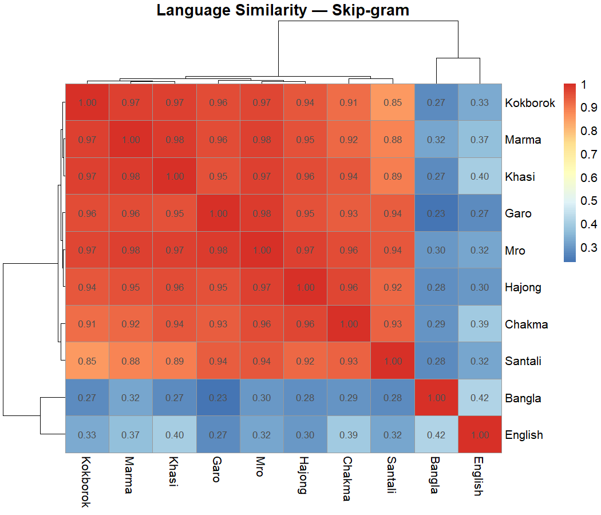
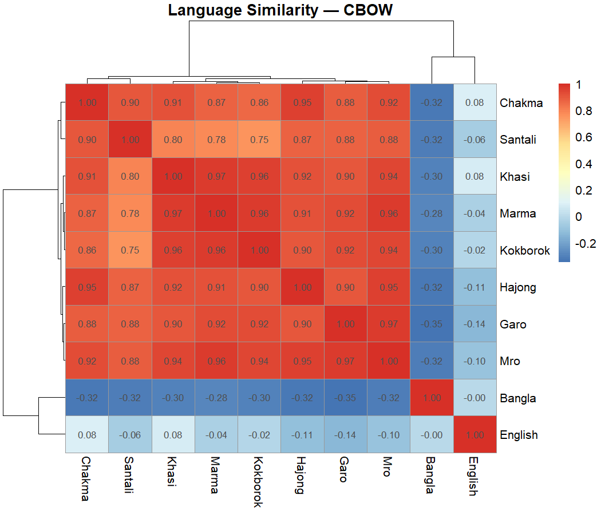
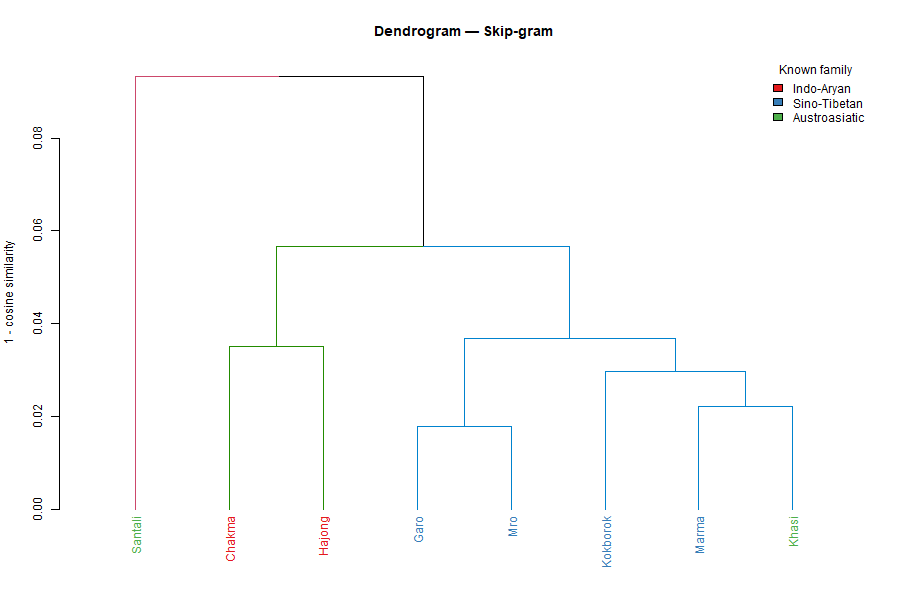
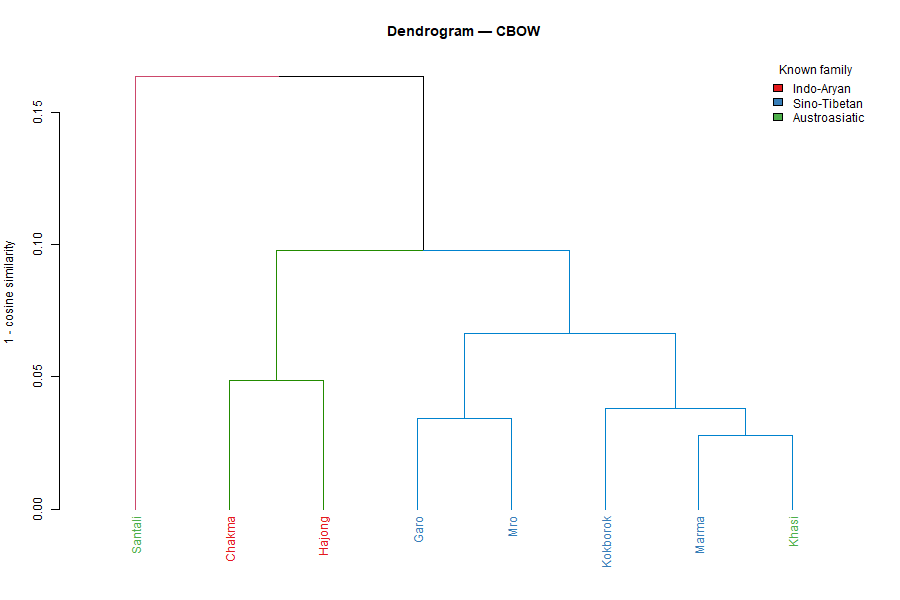

# Indigenous Language Similarity and Family Recovery in Bangladesh

### A Word2Vec-Based Computational Analysis of Indigenous Languages

This project explores potential linguistic relationships among indigenous languages of Bangladesh using Word2Vec embeddings, cosine similarity, hierarchical clustering, and comparative lexical analysis.

The study investigates how computational language representations can help identify patterns of similarity among indigenous languages and their relationships with Bangla and English.

The project compares two Word2Vec architectures—Skip-gram and Continuous Bag of Words (CBOW)—to examine language-level similarity patterns and clustering behavior.

---

## 📌 Project Overview

Bangladesh is home to several indigenous language communities with distinct linguistic and cultural identities. Understanding the relationships among these languages is important for linguistic research, language documentation, and the preservation of linguistic diversity.

This project applies computational techniques to explore similarities among eight indigenous languages of Bangladesh:

- Chakma
- Marma
- Garo
- Kokborok
- Santali
- Khasi
- Mro
- Hajong

Bangla and English are also included as reference languages.

The project constructs language-level vector representations from Word2Vec word embeddings and compares the resulting similarity structures.

The main objective is to investigate whether different embedding architectures reveal consistent patterns of linguistic similarity and clustering among the selected languages.


## 🎯 Project Objectives

The main objectives are:

1. Collect and organize sentence-level data for selected indigenous languages of Bangladesh.
2. Develop a preprocessing pipeline for multilingual text data.
3. Train Word2Vec models using Skip-gram and CBOW architectures.
4. Construct language-level vector representations from word embeddings.
5. Calculate pairwise cosine similarity between language representations.
6. Apply hierarchical clustering to explore language groupings.
7. Compare embedding-based similarity with a lexical edit-distance baseline.
8. Investigate relationships between computational similarity patterns and potential linguistic or geographical factors.

---

## 🌐 Languages Included

| Category | Languages |
|---|---|
| Reference languages | Bangla, English |
| Indigenous languages | Chakma, Marma, Garo, Kokborok, Santali, Khasi, Mro, Hajong |

The analysis focuses on the eight selected indigenous languages, with Bangla and English serving as reference languages.

---

## 📊 Dataset Overview

The dataset was compiled through web scraping and organized for computational language analysis.

### Dataset Statistics

| Description | Count |
|---|---:|
| Raw records | 5,906 |
| Records after cleaning | 5,842 |
| Unique Bangla entries | 786 |
| Unique English entries | 810 |

### Indigenous Language Distribution

| Language | Records |
|---|---:|
| Chakma | 543 |
| Garo | 736 |
| Hajong | 775 |
| Khasi | 765 |
| Kokborok | 759 |
| Marma | 800 |
| Mro | 697 |
| Santali | 767 |

These counts describe the dataset used in the reported analysis.

### Dataset Structure

The dataset contains the following columns:

| Column | Description |
|---|---|
| `Bangla` | Bangla-language text |
| `English` | English-language text |
| `Indigenous` | Indigenous-language text |
| `Language` | Language label associated with the record |

### Dataset Availability and Privacy

The raw dataset is not included in this public repository.

It was compiled through web scraping for this project. The dataset is kept separate from the public code repository, and its redistribution permissions must be considered before any public release.

The repository provides the project code, selected result files, and visualizations without publishing the raw dataset.

---

## ⚙️ Methodology

The project follows a computational workflow consisting of data preparation, embedding generation, similarity analysis, clustering, and baseline comparison.

### 1. Data Collection

Sentence-level data were collected through web scraping and organized into a structured dataset containing reference-language text, indigenous-language text, and language labels.

### 2. Data Preprocessing

The preprocessing stage includes:

- Text cleaning and normalization
- Duplicate removal
- Preparation of language-specific text
- Extraction of unique reference-language entries
- Organization of the corpus for embedding training

The handling of non-ASCII characters is particularly important because several languages in the dataset use writing systems beyond basic ASCII.

### 3. Word2Vec Embedding Generation

Two Word2Vec architectures are investigated.

#### Skip-gram

Skip-gram learns to predict surrounding context words from a target word. It is evaluated for its ability to represent words based on their contextual relationships.

#### Continuous Bag of Words (CBOW)

CBOW predicts a target word from its surrounding context. Its resulting language-level representations are compared with those produced by Skip-gram.

### Word2Vec Configuration

| Parameter | Value |
|---|---:|
| Vector dimensionality | 100 |
| Context window | 5 |
| Training iterations | 20 |
| Minimum word count | 1 |
| Random seed | 42 |

These are the reported configuration settings for the main embedding experiments.

### 4. Language-Level Representation

Word embeddings are aggregated to obtain language-level vector representations.

These vectors are then used to compare languages within the trained embedding space.

The interpretation of these representations depends on the corpus construction, preprocessing, and embedding-training procedure.

### 5. Cosine Similarity Analysis

Cosine similarity is used to measure the similarity between language-level vectors.

The resulting pairwise similarity matrices are used to:

- Examine language-level similarity patterns
- Compare Skip-gram and CBOW
- Identify highly similar language pairs
- Generate similarity heatmaps

### 6. Hierarchical Clustering

Hierarchical clustering is applied to explore the grouping structure of the language representations.

Average linkage is used in the reported main analysis, with three clusters selected for the primary clustering comparison.

Dendrograms are generated to visualize the resulting hierarchical structures.

### 7. Lexical Edit-Distance Baseline

A lexical edit-distance baseline is included to provide a comparison with the embedding-based approach.

This baseline provides a different perspective on similarity by examining textual differences rather than relying on Word2Vec representations.

The corrected baseline implementation is used for the reported baseline comparison.

### 8. Comparative Evaluation

The project compares:

- Skip-gram and CBOW similarity structures
- Hierarchical clustering outcomes
- Embedding-based similarity and the lexical baseline
- Relationships between language similarity matrices

The results are exploratory and should not be interpreted as definitive linguistic classifications without further validation.

---

## 📈 Results

The following results summarize the reported main experiments.

### 1. Clustering Performance and Stability

The Adjusted Rand Index (ARI) was used to evaluate clustering
agreement with the reference labels used in the analysis.

| Method | Reported ARI |
|---|---:|
| Word2Vec Skip-gram | 0.6067 |
| Word2Vec CBOW | 0.6067 |
| Corrected edit-distance baseline | 0.3000 |

Both Word2Vec architectures achieved a reported ARI of 0.6067
in the main clustering experiment. However, the same ARI value
does not imply equivalent stability across random seeds.

**Stability consideration:** Skip-gram exhibited seed sensitivity
in the cluster-count experiments. Its intermediate-k results
should therefore be interpreted cautiously and should not be
assumed to generalize across random seeds.

CBOW was expected to be more stable in the reported analysis;
however, this interpretation should be supported by explicit
multi-seed evaluation before making a definitive stability claim.

The ARI values represent agreement with the selected reference
labels and do not independently establish genealogical language
relationships.
### 2. Selected Similarity Findings

The following pairs were reported in the main similarity analysis.

| Analysis | Reported finding |
|---|---|
| Skip-gram: closest reported indigenous-language pair | Garo–Mro, similarity 0.981 |
| CBOW: closest reported indigenous-language pair | Marma–Khasi, similarity 0.970 |
| Skip-gram: most similar to Bangla | Marma, similarity 0.3108 |
| Skip-gram: most similar to English | Chakma, similarity 0.3723 |

These values are specific to the current dataset, preprocessing pipeline, and embedding configuration.

High similarity scores should not automatically be interpreted as evidence of common ancestry. Orthographic overlap, transcription conventions, corpus composition, and other methodological factors may influence the results.

### 3. Similarity Matrix Comparison

Pairwise similarity matrices were generated for both Skip-gram and CBOW.

The matrices provide a basis for comparing the structures learned by the two architectures.

The lexical edit-distance matrix is included as a baseline for comparison.

### 4. Surface-Similarity Matrix Correlation

Mantel tests were used to investigate the relationship between the embedding-derived similarity matrices and the surface-similarity matrix.

| Embedding model | Mantel correlation (r) | Reported p-value |
|---|---:|---:|
| Skip-gram | 0.8407 | 0.0001 |
| CBOW | 0.8188 | 0.0004 |

These are the reported results from the current analysis. Their interpretation depends on the construction of the surface-similarity matrix and the validity of the underlying preprocessing and statistical assumptions.

Geographical comparisons are not presented as final findings because the geographical coordinates used in the current analysis require verification.

---

## 🖼️ Visualizations

The repository includes visualizations generated during the main experiments.

### Skip-gram Similarity Heatmap

The heatmap illustrates the pairwise similarity structure obtained from the Skip-gram language representations.



### CBOW Similarity Heatmap

The heatmap illustrates the pairwise similarity structure obtained from the CBOW language representations.



### Skip-gram Hierarchical Clustering

The dendrogram visualizes the hierarchical grouping structure derived from the Skip-gram representations.



### CBOW Hierarchical Clustering

The dendrogram visualizes the hierarchical grouping structure derived from the CBOW representations.



---

## 📁 Repository Structure

```text
indigenous-language-similarity-family-recovery-bangladesh/
│
├── README.md
├── ids_project.R
│
├── results/
│   ├── similarity_matrix_skipgram.csv
│   ├── similarity_matrix_cbow.csv
│   └── edit_distance_baseline_matrix.csv
│
└── figures/
    ├── heatmap_skipgram.png
    ├── heatmap_cbow.png
    ├── dendrogram_skipgram.png
    └── dendrogram_cbow.png
```

### File Descriptions

| File or folder | Description |
|---|---|
| `README.md` | Project overview, methodology, results, and documentation |
| `ids_project.R` | Main R analysis script |
| `results/` | Exported similarity matrices and baseline results |
| `figures/` | Visualizations from the analysis |

The raw dataset is intentionally excluded from this public repository.

---

## 🛠️ Technologies Used

- **R** — Data processing and analysis
- **Word2Vec** — Word embedding generation
- **Skip-gram** — Context-based embedding architecture
- **CBOW** — Context-prediction embedding architecture
- **Cosine Similarity** — Pairwise vector similarity
- **Hierarchical Clustering** — Exploratory grouping of language representations
- **Adjusted Rand Index (ARI)** — Clustering evaluation
- **Mantel Test** — Comparison of similarity matrices
- **Data Visualization** — Heatmaps and dendrograms

The main analysis was run using R 4.6.1 on Windows.

---

## ⚠️ Limitations

Several limitations should be considered when interpreting the results.

1. **Dataset coverage:** The dataset represents the collected web-scraped material and may not capture the full linguistic diversity of the selected languages.

2. **Data quality:** Text normalization, transcription conventions, duplicate handling, and orthographic differences can affect similarity estimates.

3. **Embedding alignment:** Language-level vectors derived from a shared training procedure do not automatically guarantee that all cross-language similarities have a clear semantic interpretation.

4. **Genealogical interpretation:** Computational similarity alone cannot establish linguistic ancestry or prove that two languages belong to the same language family.

5. **Baseline comparison:** Edit-distance results depend on how lexical items are matched, normalized, and compared.

6. **Geographical analysis:** Geographical coordinates must be verified before geographical similarity results can be interpreted as final findings.

7. **Reproducibility:** Exact reproduction requires access to the same dataset, preprocessing procedure, software environment, and model configuration.

These limitations motivate further validation using linguistically verified resources and additional independent data.

---

## 🔬 Future Work

Potential extensions of this project include:

- Validating the similarity patterns with expert linguistic knowledge
- Improving Unicode-aware preprocessing for all included writing systems
- Evaluating character-level and multilingual embedding baselines
- Testing clustering stability across different random seeds and cluster counts
- Investigating the effect of corpus size and data balance
- Verifying geographical metadata before performing geographical comparisons
- Evaluating the robustness of similarity patterns on independently collected data
- Exploring whether the observed computational relationships agree with established linguistic classifications

---

## 🔁 Reproducibility

The main analysis script is provided in this repository.

To reproduce the experiments, users will need to prepare the dataset locally and configure the script to read the appropriate input file.

The raw dataset is not publicly included. Therefore, the repository alone does not provide everything required to reproduce the numerical results from scratch.

Reproduction may also depend on the R version and the packages used by the script.

---

## 📜 Data and Usage Notice

This repository provides code, selected results, and visualizations for educational and research purposes.

The raw dataset is maintained separately and is not publicly distributed through this repository.

Users should verify the applicable source terms and permissions before collecting, redistributing, or reusing web-scraped language data.

The code and exported results should be interpreted in the context of the methodology and limitations documented above.

---

## 👩‍💻 Project Information

**Project:** Indigenous Language Similarity and Family Recovery in Bangladesh

**Primary methods:** Word2Vec, cosine similarity, hierarchical clustering, and lexical edit-distance comparison

**Implementation language:** R

**Focus:** Computational exploration of indigenous language similarity in Bangladesh

---

*This project is an exploratory computational analysis intended to support further investigation of linguistic similarity and language documentation.*
